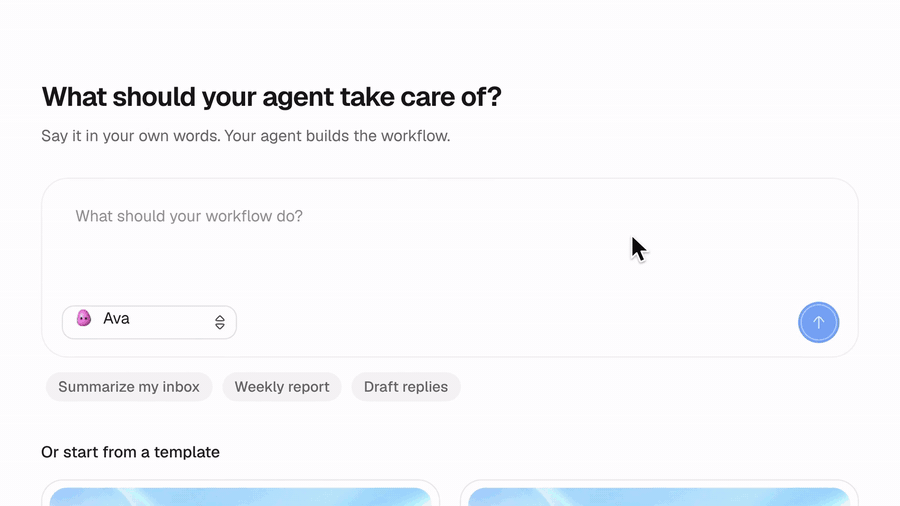

# product-demo-video



An agent skill that turns a real web app into a fast, polished demo video. It runs your app with mock data, drives it with a visible cursor, and records every frame against a frozen clock. Camera zooms, speed ramps, word-by-word captions, sound and an end card are added in post. The clip above is a few seconds of a 41 second film made this way.

Works with any agent that reads `SKILL.md` skills, such as Claude Code. The scripts also run on their own.

## What you get

- Frame-exact capture. The page clock is paused and stepped, so every take is identical and nothing stutters.
- A real UI with invented data. Fake the network, seed local state or inject a story script.
- A cursor with arced moves and press feedback, typed text with a natural rhythm, and scrolling.
- Zooms and pans that fit a recorded element, plus speed ramps that compress loading moments.
- Captions that build word by word, an end card, and a synthesized soundtrack with click and key sounds. No licensed audio.
- Render checks and one-frame-per-second contact sheets, so you can read the film before sharing it.

## Install

Requirements are Node 20 or newer, Python 3 with Pillow and numpy, and ffmpeg.

```bash
git clone https://github.com/amrtawfik160/product-demo-video.git
cd product-demo-video/skills/product-demo-video
npm install
npx playwright install chromium
pip install pillow numpy
node scripts/run.mjs --doctor
```

To let an agent use it, copy or symlink the skill folder into the agent's skills directory. For Claude Code that is `~/.claude/skills/`:

```bash
mkdir -p ~/.claude/skills
ln -s "$PWD" ~/.claude/skills/product-demo-video
```

Then ask for a demo video of your app. The agent reads `SKILL.md` and follows it.

## Try the bundled example

The example is a one-file page in `examples/tiny-app/`. Its data comes from a faked `/api/plan` response. Run this from `skills/product-demo-video`, where the install steps left you.

```bash
node scripts/run.mjs examples/tiny-app/demo.config.json
```

That captures the page, builds the overlays and sound, composes the film and runs the checks. It writes the MP4, `check.json` and contact sheets to `examples/tiny-app/out/`. Add `--draft` for a one-minute pass at lower quality (`npm test` does exactly that and fails if a check fails), or `--dry` to validate the script in seconds. Drafts are written to `out/draft/`, apart from the full render.

## Make your own

1. Copy `examples/tiny-app/demo.config.json` and point `app` at your app, either a folder to serve or a running URL.
2. Write the `steps`: move, click, type, wheel, wait, with `mark` names on the moments you care about.
3. Add `camera` moves and `captions` that reference those marks.
4. Run `--dry`, then `--draft`, then the full render, and read the contact sheets after each.

The full field list is in `skills/product-demo-video/references/config.md`. Ways to get mock data into an app are in `references/mocking.md`. Read `references/pitfalls.md` before the first capture on a new app.

## How it works

| Stage | What happens |
|---|---|
| capture | Playwright opens the app with a page clock that is paused and stepped one frame at a time. CSS animations are stepped by hand. Each frame is a dense screenshot. The cursor path, clicks and key events go to `track.json`. |
| assets | Chromium renders the cursor, caption pills (one image per word) and the end card. |
| plan | Works out the film length from the capture. |
| audio | Synthesizes a soft score and click and key sounds from the logged events. |
| film | For each output frame, crops the camera window from the dense capture, draws cursor and captions, fades to the end card, and pipes raw frames into ffmpeg. |
| check | Reads the MP4 back and reports length, size, audio, flat frames, frozen stretches and loudness. |

## Credits

- [Playwright](https://playwright.dev) drives the browser and the page clock. Apache-2.0.
- [Pillow](https://python-pillow.org) and [NumPy](https://numpy.org) compose frames and synthesize audio.
- [FFmpeg](https://ffmpeg.org) encodes and measures the video.

The cursor art, caption styling, camera easing and sounds are original to this repository. Nothing is copied from other skills.

## Licence

MIT. See `LICENSE`.
